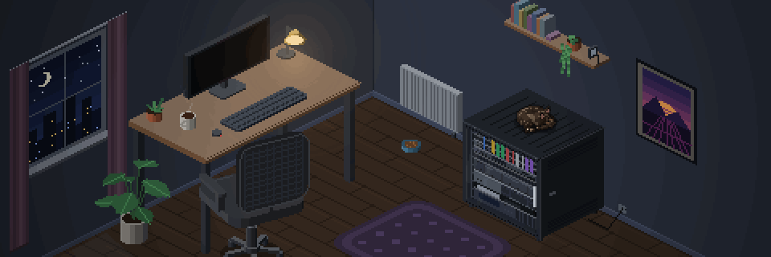
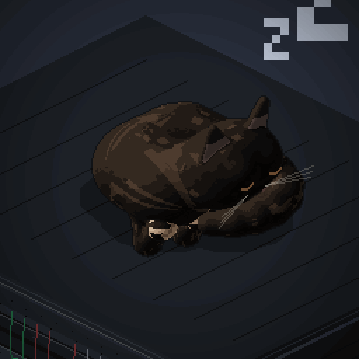
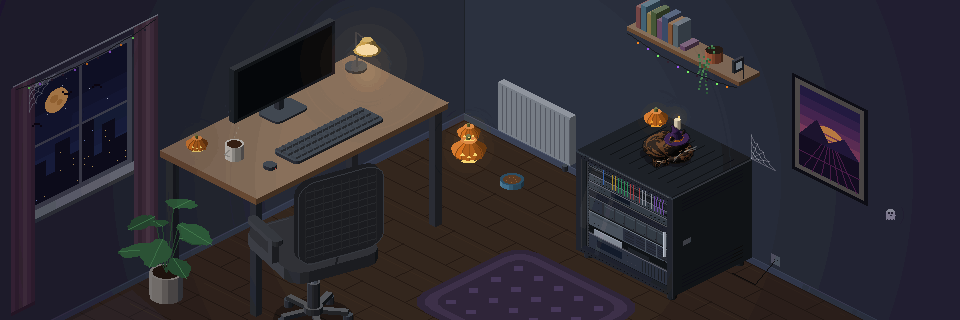
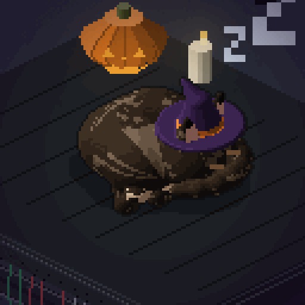
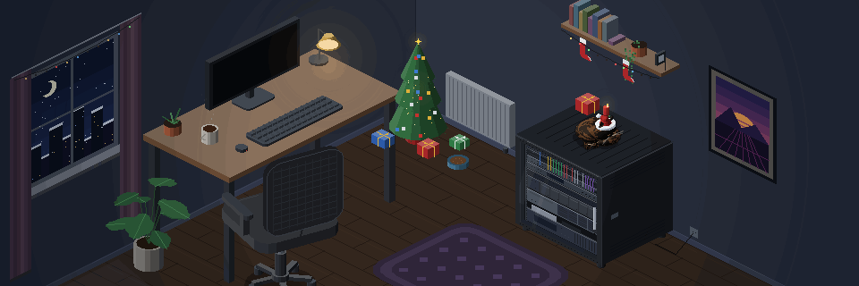
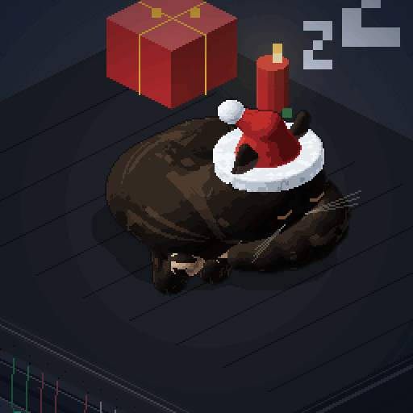

# cat-banner

Ma chatonne écaille de tortue en pixel art isométrique 3D : une **bannière** animée (elle dort sur la baie serveur, se réveille, se roule sur le clavier et éteint tout) et un **avatar** assorti (gros plan, lent clignement d'yeux).

Tout tourne dans le navigateur avec un seul fichier JavaScript, sans dépendance. Un script Node permet d'exporter les animations en GIF (Discord, GitHub, etc.).

| Bannière | Avatar |
|---|---|
|  |  |
|  |  |
|  |  |

Démo des thèmes : `index.html?theme=halloween` ou `index.html?theme=noel`.

## Structure

```
cat-banner/
├── index.html          # démo : bannière + avatar en rond (style profil Discord)
├── src/
│   └── cat-scene.js    # le moteur complet (décor, chatonne 3D, animations)
├── tools/
│   └── export.js       # export GIF / PNG
├── exports/            # GIF et PNG générés
└── package.json
```

## Voir la démo

Ouvrir `index.html` dans un navigateur, ou servir le dossier :

```bash
npx serve .
```

## Utiliser dans une page

```html
<div class="cat-banner"><canvas id="banner"></canvas></div>

<script src="src/cat-scene.js"></script>
<script>
  CatScene.create(document.getElementById('banner'), { preset: 'banner' });
</script>
```

Le CSS de la bannière (pleine largeur, ratio 3:1, pixels nets) est dans `index.html`.

### Options de `CatScene.create(canvas, options)`

| Option | Rôle |
|---|---|
| `preset` | `'banner'` (960×320, scénario de 23,5 s), `'avatar'` (256×256, 8 s), `'wallpaper'` (960×540, vie autonome) ou `'portfolio'` (960×412, environ 21:9 : la baie, le bureau et le tapis du grand appartement, vie autonome sans la coupure de la baie par le clavier) |
| `quality` | `'hd'` par défaut, ou `'standard'` (deux fois moins de pixels, beaucoup plus léger à animer en direct) |
| `autoplay` | `false` pour ne pas lancer l'animation (utile pour l'export) |
| `theme` | `'halloween'` : citrouilles, bougie, toiles d'araignée, guirlandes, chauves-souris, fantôme, lune orange, chapeau de sorcière. `'noel'` : sapin illuminé avec étoile, cadeaux, chaussettes, guirlandes, neige derrière la fenêtre, bougie, bonnet de père Noël |
| `cat` | surcharge l'apparence, par exemple `{ eyes: '#e0b040', flecksAmount: 0, hat: true }` |
| `width`, `height`, `K`, `OX`, `OY` | taille du canvas, zoom et cadrage (avancé) |
| `activities` | vie autonome : poids de chaque activité, multiplié au poids normal (`0` = jamais, `2` = deux fois plus souvent). Noms : `napRack`, `napSofa`, `napTree`, `napSun`, `eat`, `drink`, `window`, `groom`, `roll`, `ball`, `scratch`, `zoomies`, `box`, `sit`, `keyboard`, `celebrate`. Les poids passés complètent ceux du préréglage |
| `nightActivities` | vie autonome : poids supplémentaires appliqués la nuit seulement (avant 6 h 30 et après 23 h). `portfolio` : `{ napRack: 2.5 }`, la sieste sur la baie devient plus fréquente |
| `incidentCooldown` | délai (ms) avant qu'un même appareil puisse redéclencher l'activité `incident` (10 minutes par défaut) |
| `inputTarget` | vie autonome : élément qui reçoit la souris et le doigt (par défaut toute la fenêtre, comme le fond d'écran) |
| `fps` | plafond d'images par seconde en lecture (30 pour les préréglages en direct) |
| `catFps` | rythme de recalcul de la chatonne (le plus coûteux) ; entre deux calculs elle est réaffichée telle quelle. 15 pour `portfolio` |
| `status` | état réel des appareils de la baie, voir `setStatus` ci-dessous. Sans cette option, la baie vit sa vie |
| `screenText`, `screenColor` | texte affiché sur l'écran du bureau, voir `setScreenText` |

`create` renvoie `{ frame(ms), start(), pause(), resume(), isPaused(), play(nom), getHotspots(), duration, canvas, setWeather(w), setStatus(carte), setScreenText(texte, couleur), pointer(x, y), pointerLeave(), toggleLaser(), set(clé, valeur) }`.

**État réel de la baie** : `setStatus({ fw, switch, server, nas, isp, mini, ups })`, chaque valeur valant `'up'` (voyants animés comme d'habitude), `'down'` (rouge fixe), `'degraded'` (orange fixe) ou `'unknown'` (éteints, gris). Un appareil absent de la carte est `'unknown'` : aucun vert sans donnée. Les appareils : `fw` pare-feu (U9), `switch` (U10), `server` serveur 2U (U6-7), `nas` (U4-5), `isp` box internet et `mini` mini PC (U3), `ups` onduleur (U1-2).

**Incident** : quand un appareil passe `'down'` (ou l'est déjà au démarrage), la chatonne va s'asseoir au sol devant la baie et fixe l'appareil 8 à 12 s. C'est prioritaire sur les activités au hasard, mais n'interrompt jamais une poursuite de laser ; chaque appareil a un délai de recharge (`incidentCooldown`).

**À la demande** : `play(nom)` lance une activité dès que possible (jamais pendant le laser) et renvoie `false` si le nom est inconnu. L'activité `celebrate` (zoomies puis pluie de cœurs) n'est jamais tirée au hasard, seulement demandée.

**Zones à l'écran** : `getHotspots()` renvoie `{ width, height, devices: { nas: { x, y, w, h, points } ... }, cat: { x, y, w, h } }` en pixels du canvas : rectangle englobant et les 4 coins de la façade de chaque appareil, boîte serrée de la chatonne (dernière image calculée). Pour poser des éléments HTML par-dessus un canvas affiché en `object-fit: cover`, appliquer l'échelle `max(largeur affichée / width, hauteur affichée / height)` et le centrage.

**Écran du bureau** : `setScreenText('OK 5/5', '#3ddc84')` remplace les lignes de log par un texte en police pixel 3×5 (11 caractères au plus : lettres sans accent, chiffres, `/ ? : .`). `setScreenText(null)` rétablit les lignes. `frame(ms)` dessine l'image à un instant donné de la boucle. `pause()` fige l'image et arrête tout calcul, `resume()` reprend là où elle s'était arrêtée.

Au doigt (vie autonome) : un tap sur la chatonne la caresse, un appui long (0,45 s) allume le laser, qui suit le doigt tant qu'il reste posé. Tant que le laser n'est pas allumé, le glissé fait défiler la page.

Pour une page qui affiche le préréglage `portfolio`, une image fixe sert d'affiche avant le démarrage du canvas : `npm run export:portfolio` produit `exports/portfolio-jour.png` (14 h) et `exports/portfolio-nuit.png` (21 h), voyants de la baie éteints (`--status=unknown`), pour n'afficher aucun état inventé.

L'animation se met en pause quand elle n'est pas visible à l'écran et affiche une image fixe si le visiteur a activé la réduction des animations.

## Fond d'écran animé (Wallpaper Engine)

Le dossier `wallpaper/` est un fond d'écran web prêt à importer : un grand appartement en 16:9 où la chatonne vit sa vie (siestes sur la baie, le canapé, en haut de l'arbre à chat ou au soleil, gamelle, eau, toilette, fenêtre, griffes, carton, sprints, et de temps en temps le clavier qui coupe tout). Le jour et la nuit suivent l'heure réelle (ciel, soleil qui entre par la fenêtre, lumière de la pièce).

Import : Wallpaper Engine > *Créer un fond d'écran* > choisir `wallpaper/index.html` (ou copier le dossier dans `myprojects`). Après une modification de `src/cat-scene.js`, lancer `npm run build:wallpaper` pour mettre à jour la copie.

Météo réelle via [Open-Meteo](https://open-meteo.com) (gratuit, sans clé), mise à jour toutes les 20 minutes : pluie et gouttes sur la vitre, neige, orage avec éclairs, brouillard, ciel couvert. La ville et la météo (réelle ou forcée) se règlent dans Wallpaper Engine.

À la souris : un double-clic allume ou éteint le point laser (réglable : clic maintenu, ou mouvement rapide). Elle le poursuit, se ramasse à portée, remue l'arrière-train et bondit pour retomber les pattes sur le point. Le point marche aussi sur les meubles (canapé, bureau, baie, arbre à chat, banquette de fenêtre) : elle saute dessus pour le suivre et redescend quand il retombe au sol. Laser éteint, le survol de la chatonne la caresse : elle ferme à moitié les yeux et des cœurs apparaissent. L'entrée souris doit être activée dans Wallpaper Engine.

Dans une page : `CatScene.create(canvas, { preset: 'wallpaper' })`, puis `scene.setWeather('rain')` ou `scene.setWeather(codeWMO)`. Options utiles : `hour` (heure simulée), `timeScale` (accélère le temps), `script` (liste d'activités dans l'ordre, par exemple `['eat', 'window', 'box']`).

## Faire évoluer la chatonne

Tout se passe dans `src/cat-scene.js` :

- **Couleurs, yeux, mouchetures** : l'objet `CAT_STYLE` tout en haut (pelage, mouchetures, intérieur des oreilles, yeux, nez, quantité de mouchetures).
- **Proportions** (pour la faire grandir) : fonction `buildCat`, sections *Corps : 3 segments arrondis* (rayons `rs`, longueur `seg`), *Tête* (rayon de la tête, joues, museau, oreilles), *Pattes* (longueurs `a` et `b`, épaisseurs) et *Queue* (rayons `tr`, nombre de segments).
- **Poses** : section *Poses du chat* (`STAND`, `SLEEP`, `CROUCH`, `TAKEOFF`, `BELLY`, `SIT`...). Chaque pose est une liste de paramètres (hauteur du corps, courbure, position des pattes, queue, yeux, bouche, roulade...) et les animations passent de l'une à l'autre en douceur.
- **Scénarios** : `PH_BANNER` et `PH_AVATAR`, deux listes de `[durée en ms, fonction]`. Chaque fonction reçoit l'avancement de l'étape (0 à 1) et renvoie la pose, la position et l'état de la baie et de l'écran.
- **Décor** : `drawRoom`, `drawDesk`, `drawRack` (baie 12U), `drawChair`, `drawPlant`, `drawWindow`...
- **Thèmes** : Halloween (section *Halloween*, drapeau `HW`) et Noël (section *Noël*, drapeau `XM`). Chaque thème a une partie fixe (dessinée une fois) et une partie animée (redessinée à chaque image). Pour un nouveau thème, suivre le même modèle.

## Exporter en GIF

Nécessite Node.js 18 ou plus. Sur les versions récentes de Node (26 et plus), `canvas` 2 n'a pas de binaire précompilé : `npm install --no-save canvas@3` le remplace sans toucher au `package.json`.

```bash
npm install
npm run export           # bannière + avatar en GIF, plus les PNG fixes
npm run export:banner    # exports/banniere.gif (960×320)
npm run export:avatar    # exports/avatar.gif (512×512)
npm run export:png       # exports/avatar.png et exports/banniere.png
npm run export:halloween # les mêmes fichiers en version Halloween (suffixe -halloween)
npm run export:noel      # version Noël (suffixe -noel)
npm run export:portfolio # exports/portfolio-jour.png et exports/portfolio-nuit.png (960×412)
```

Options : `node tools/export.js banner --fps=15 --scale=3`. Image fixe de n'importe quel préréglage : `node tools/export.js still wallpaper --hour=8 --name=matin`.

`canvas` fournit des binaires précompilés pour la plupart des systèmes. Sinon, voir la [documentation de node-canvas](https://github.com/Automattic/node-canvas#compiling) pour les dépendances à installer.

## Comment ça marche

- **Décor** : formes extrudées en projection isométrique 2:1, remplies ligne par ligne pour garder des bords nets, ombrées selon leur orientation. Le décor fixe est dessiné une seule fois dans un calque, seuls les éléments animés (voyants, écran, clavier, vapeur, étoiles) sont redessinés.
- **Chatonne** : modèle 3D décrit par un champ de distance (capsules et sphères fusionnées en douceur), rendu par lancer de rayons à chaque image puis quantifié sur une palette. Les pattes utilisent une cinématique inverse à deux os, la queue est une chaîne de segments, et le motif du pelage est attaché à chaque partie du corps.
- **GIF** : palette commune sur toute la boucle, et seuls les pixels qui changent sont encodés d'une image à l'autre (d'où la petite taille).

## Idées pour la suite

- La faire grandir au fil des mois (proportions, taille, longueur du poil)
- Jouer avec un jouet, manger dans la gamelle, se percher sur la chaise
- Cycle jour / nuit, saisons dans la fenêtre
- Nouvelles scènes pour d'autres formats (bannière Twitch, fond d'écran)

## Licence

À choisir avant de publier (par exemple MIT).
